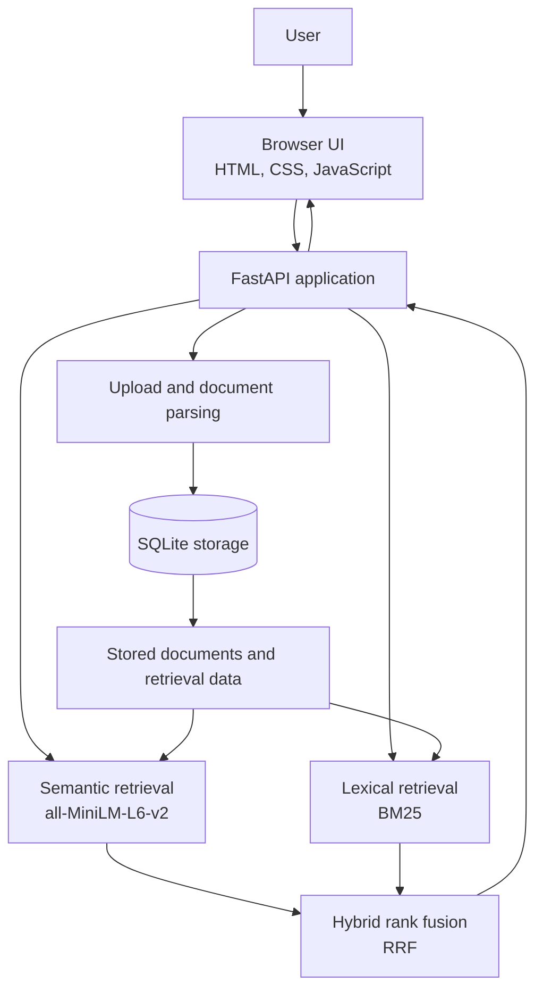
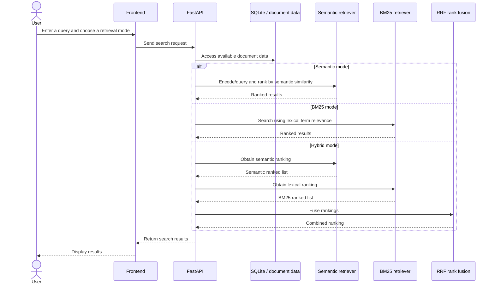
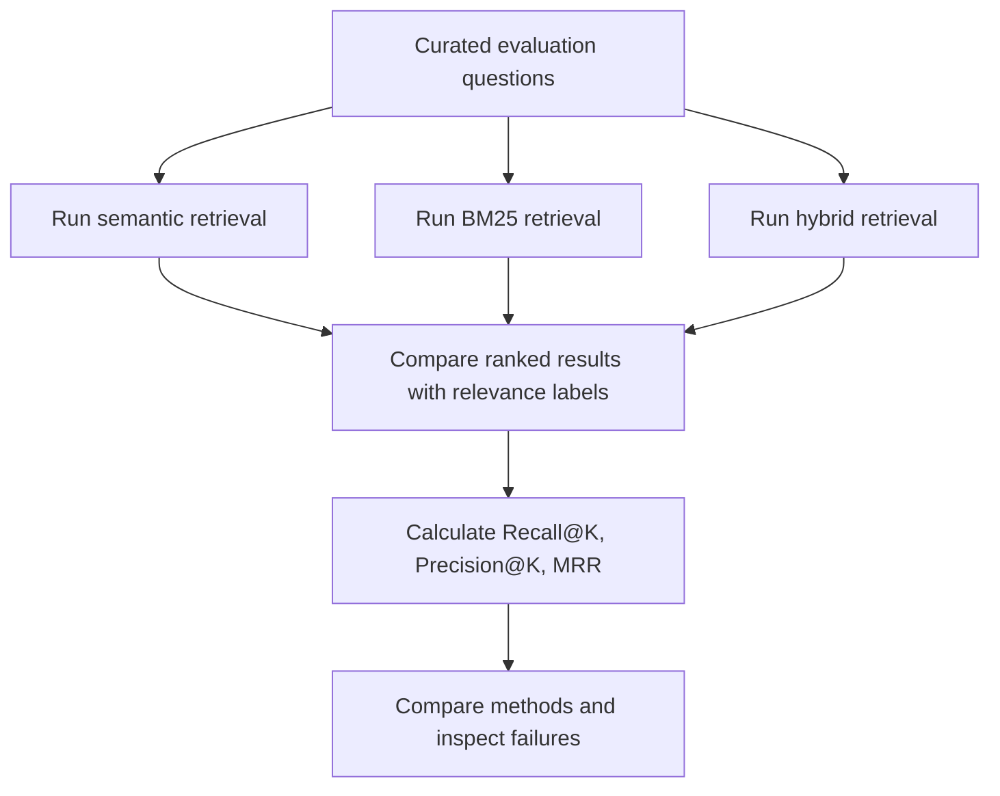

# DocFind — Intelligent Document Retrieval & Evaluation Platform

> **Purpose:** Project documentation, technical reference, and placement-interview study guide.  
> **Repository:** https://github.com/iamrushi100/intelligent-document-retrieval  
> **Local development environment:** Windows, Python 3.13, VS Code, virtual environment `.venv`

---

## 1. Project at a glance

**DocFind** is an end-to-end document retrieval application. It lets a user upload documents and search for relevant information using multiple retrieval approaches. It combines semantic retrieval, keyword-based BM25 retrieval, and hybrid ranking using Reciprocal Rank Fusion (RRF). It also includes persistent storage, a web interface, and an evaluation pipeline.

### The problem it addresses

A simple keyword search can miss relevant content when a user phrases a query differently from the wording in a document. Semantic search can help match meaning, but it may not always rank exact terms as well as a lexical method. DocFind provides several retrieval methods and a hybrid option so their behavior can be compared.

### Main capabilities implemented

- FastAPI backend.
- Document upload and parsing.
- Semantic retrieval using `sentence-transformers/all-MiniLM-L6-v2`.
- Lexical retrieval using BM25.
- Hybrid ranking using Reciprocal Rank Fusion (RRF).
- SQLite storage.
- Plain HTML, CSS, and JavaScript frontend served from `app/static/`.
- Evaluation pipeline using Recall@K, Precision@K, and Mean Reciprocal Rank (MRR).
- Automated tests.
- Git version control and a GitHub-hosted repository.
- Ignore rules for generated files and local environment folders, including `.venv/`, caches, `data/`, and `.env`.

> **Accuracy note:** This guide records the implementation and test/evaluation results known at the time it was written. Check the current code and rerun tests before presenting any result as the latest result. Features not listed here should not be claimed in an interview unless you verify them in the code.

---

## 2. Architecture overview

### 2.1 High-level system architecture



**How to read it:** The browser sends requests to FastAPI. Uploaded documents are parsed and stored. A search request can use semantic retrieval, BM25, or the hybrid ranker. FastAPI returns results to the browser for display. The exact internal call sequence and which objects are persisted should be confirmed in the current source code.

### 2.2 Search request flow



This diagram is a conceptual flow of the documented retrieval approaches, not a claim about exact function names or endpoint paths.

### 2.3 Document ingestion flow


Confirm the exact supported file extensions, validation rules, storage schema, and parsing behavior in the current code before describing them as guarantees.

### 2.4 Evaluation flow



---

## 3. Technology stack and why it is used

| Technology | Role in DocFind | Interview explanation |
|---|---|---|
| Python 3.13 | Main implementation language | Ecosystem supports APIs, NLP, information retrieval, and testing. |
| FastAPI | Backend web framework | Defines HTTP endpoints and connects frontend requests to application logic. |
| `sentence-transformers/all-MiniLM-L6-v2` | Semantic representation of text | Represents text as dense vectors so semantically similar text can be matched even when wording differs. |
| BM25 | Lexical retrieval method | Ranks documents using query-term matches with term-frequency and document-length considerations. |
| Reciprocal Rank Fusion (RRF) | Hybrid ranking | Combines rankings from different retrieval systems without requiring their raw scores to be directly comparable. |
| SQLite | Database | Provides local relational persistence without requiring a separate database server. |
| HTML, CSS, JavaScript | Frontend | Creates the browser interface served by the FastAPI application. |
| pytest | Automated tests | Checks expected behavior and helps prevent regressions. |
| Git and GitHub | Version control and hosting | Preserves project history and makes the code available for review. |

---

## 4. Understanding the retrieval methods

### 4.1 Semantic retrieval

Semantic retrieval aims to match the **meaning** of a query with document content, not just identical words.

1. Text is passed through the Sentence Transformers model.
2. The model produces dense vector representations (embeddings).
3. Query and document representations are compared using the similarity approach implemented by the project.
4. Results are ranked by the implementation's semantic score.

**Example:** A query such as “How can I make an account safer?” may be related to document text about “improving account security,” even though the wording differs.

**Strength:** Can retrieve relevant content with different wording.

**Limitations:** Embedding models can miss precise identifiers, rare terms, or domain-specific meanings. Model inference also uses computational resources. Verify the exact similarity metric and whether embeddings are cached or persisted in the current implementation.

### 4.2 BM25 lexical retrieval

BM25 is a ranking function used in information retrieval. It rewards useful query-term matches while accounting for term frequency, how common a term is across the corpus, and document length.

**Strength:** Often effective for exact words, technical terms, names, and identifiers.

**Limitation:** It may miss a relevant passage when the query and document use different vocabulary.

BM25 is not a language model and does not inherently understand the meaning of a sentence.

### 4.3 Hybrid retrieval and Reciprocal Rank Fusion

The project combines semantic and BM25 rankings using RRF. RRF is useful when retrieval systems produce scores on different scales because it combines **rank positions**, rather than adding raw scores directly.

A common RRF formula is:

\[
\operatorname{RRF}(d) = \sum_{r \in R} \frac{1}{k + \operatorname{rank}_r(d)}
\]

Where:

- \(d\) is a document.
- \(R\) is the set of ranked result lists being combined.
- \(\operatorname{rank}_r(d)\) is the position of document \(d\) in ranking \(r\).
- \(k\) is a smoothing constant used by RRF.

A document ranked highly by multiple retrieval methods tends to receive a stronger combined score. The precise constant, rank indexing convention, and handling of documents absent from one ranking depend on the implementation.

**Why use hybrid retrieval?** Semantic retrieval contributes meaning-based matching, while BM25 contributes lexical matching. RRF can combine the two without requiring their raw relevance scores to be calibrated to the same scale.

---

## 5. Evaluation: what the metrics mean

DocFind includes an evaluation pipeline that compares semantic, BM25, and hybrid retrieval using relevance-labelled questions.

### Recall@K

The fraction of all known relevant documents that appear in the top \(K\) results.

\[
\operatorname{Recall@K} =
\frac{\text{relevant documents in top }K}
{\text{all relevant documents}}
\]

High recall means the system finds a large share of the relevant documents.

### Precision@K

The fraction of the top \(K\) returned documents that are relevant.

\[
\operatorname{Precision@K} =
\frac{\text{relevant documents in top }K}{K}
\]

High precision means fewer irrelevant results appear in the selected top results. The exact implementation may handle queries with fewer than \(K\) results or no relevant documents according to its own convention.

### Mean Reciprocal Rank (MRR)

MRR measures how early the first relevant result appears. For each query, reciprocal rank is \(1/r\), where \(r\) is the position of the first relevant result; it is zero if no relevant result is found. MRR is the average across queries.

\[
\operatorname{MRR} =
\frac{1}{N}\sum_{i=1}^{N}\frac{1}{r_i}
\]

A higher MRR indicates that users are more likely to see a relevant result near the top.

### Recorded evaluation snapshot

A prior evaluation run used:

- **30 curated questions**
- **8 short TXT documents** in the corpus
- **26 answerable questions and 4 unanswerable questions**
- **Candidate depth: 10**
- Metrics reported at **K = 5**

| Retrieval method | Recall@5 | Precision@5 | MRR |
|---|---:|---:|---:|
| Semantic | 1.0000 | 0.2000 | 1.0000 |
| BM25 | 1.0000 | 0.2000 | 0.9808 |
| Hybrid (RRF) | 1.0000 | 0.2000 | 1.0000 |

**Interpret these results carefully:**

- On this small, curated evaluation set, all three methods achieved the recorded Recall@5 of 1.0000.
- Semantic and hybrid retrieval achieved the recorded MRR of 1.0000; BM25's recorded MRR was 0.9808.
- Precision@5 of 0.2000 indicates an average of one relevant result per five returned positions under the evaluation's scoring convention.
- These results do **not** establish that the system will achieve the same quality on large, diverse, noisy, or real-world document collections.
- The four unanswerable questions make it important to inspect how the evaluation treats queries with no relevant document and whether the application can confidently indicate “no answer.” Do not claim reliable abstention or production-grade answerability detection unless verified.

For an improved evaluation, expand the corpus and question set, include varied query wording and difficult negative examples, label relevance consistently, compare more values of \(K\), record latency, and examine incorrect rankings.

---

## 6. Tests and quality checks

A previously recorded test run completed with:

```text
python -m pytest -q
42 passed in 47.06s
1 existing Starlette/httpx deprecation warning
```

A previous `git diff --check` also completed cleanly.

These are **historical recorded results**, not a guarantee that tests pass in the current checkout. To verify the current version, run:

```powershell
python -m pytest -q
git diff --check
```

If tests fail, read the first failure and traceback before making changes. Do not remove a test simply to make the suite pass.

---

## 7. Running the project on Windows

The known local project directory is:

```text
D:\Placement 2026\Projects\Project 1
```

Open this folder in VS Code and use its integrated PowerShell terminal.

### Step 1 — Activate the virtual environment

If `.venv` already exists:

```powershell
.\.venv\Scripts\Activate.ps1
```

The prompt should begin with `(.venv)`.

### Step 2 — Install dependencies

Use the project's dependency manifest if one exists. For example, if the repository contains `requirements.txt`:

```powershell
python -m pip install -r requirements.txt
```

Do not create a new dependency list from memory if the project already has one. If there is no `requirements.txt`, inspect the repository's setup instructions and package configuration first.

### Step 3 — Start the FastAPI app

The exact ASGI import path was not recorded in this document. Inspect the project for the FastAPI instance (commonly named `app`) and use its actual Python module path. The command pattern is:

```powershell
python -m uvicorn <module_path>:app --reload
```

Replace `<module_path>` with the real module path from the repository; do not type the angle brackets literally. For example, a module at `app/main.py` might use `app.main:app`, but verify the actual file and object name first.

### Step 4 — Open the application

Read the terminal output for the local URL printed by Uvicorn, commonly `http://127.0.0.1:8000`. Open the confirmed URL in your browser. If the project exposes interactive API documentation, FastAPI commonly serves it at `/docs`; verify that route is enabled.

### Step 5 — Verify behavior

1. Upload a small supported document.
2. Search using a phrase from that document.
3. Try a query that uses different wording for the same concept.
4. Compare semantic, BM25, and hybrid results if the UI offers those modes.
5. Check the results and any error messages.
6. Stop the local server with `Ctrl+C` when finished.

---

## 8. Repository, Git, and project hygiene

**GitHub repository:** https://github.com/iamrushi100/intelligent-document-retrieval

The last recorded Git status was:

```text
On branch main
Your branch is up to date with 'origin/main'.

nothing to commit, working tree clean
```

The recent commit history included:

```text
531d905 Merge initial GitHub repository
955bf43 Initial commit
98584f7 Add document retrieval web frontend
f4b9e6b Complete document retrieval evaluation platform
```

This confirms that the local `main` branch and `origin/main` were synchronized at that check.

### `.gitignore` and files to keep out of Git

The recorded ignore rules include local virtual environments, Python caches, build output, `data/`, and `.env`. These help prevent generated files, local data, and secrets from being committed accidentally.

Before pushing changes:

```powershell
git status
git diff --check
git diff
```

After reviewing the changes:

```powershell
git add <files-you-intend-to-commit>
git commit -m "Describe the change"
git push
```

Replace the placeholder with the actual files you want to stage. Avoid `git add .` if you have not checked for private data, generated files, or local evaluation artifacts.

**Security reminder:** Never commit API keys, passwords, access tokens, private documents, or a populated `.env` file. A `.gitignore` rule does not remove a secret that was already committed.

---

## 9. Known implementation scope and items to verify

The features documented as implemented are the FastAPI backend, document upload/parsing, semantic retrieval, BM25, RRF hybrid ranking, SQLite storage, browser frontend, evaluation metrics, tests, and GitHub repository.

The following details are **not established by this document** and should be checked in code before being claimed:

- Exact API endpoint names and request/response schemas.
- Exact list of accepted file types and maximum upload size.
- Authentication, authorization, and multi-user access controls.
- Exact database tables and schema migrations.
- Whether embeddings are cached, persisted, or recalculated.
- Exact distance/similarity metric used by semantic retrieval.
- Exact RRF constant and tie-breaking behavior.
- Production deployment, Docker support, CI/CD, monitoring, and rate limiting.
- Production-scale performance, security testing, and large-corpus benchmarks.
- Whether unanswerable questions trigger a reliable abstention response.

Treat these as verification points or future improvements, not as existing features.

---

## 10. Sensible next upgrades

These are **suggested future improvements**, not claims that they have already been implemented.

1. **Reproducible setup:** Ensure the dependency manifest and setup instructions work from a clean environment.
2. **Stronger evaluation:** Add a larger and more diverse labelled corpus, more queries, edge cases, and repeatable evaluation reports.
3. **Search diagnostics:** Record retrieval latency and inspect examples where semantic and BM25 rankings disagree.
4. **Document handling:** Test empty files, duplicate uploads, unsupported formats, malformed documents, and unusually large files.
5. **Error handling:** Give users clear validation messages and predictable API errors.
6. **Security review:** Validate upload content and size, keep secrets out of source control, and review file-handling risks.
7. **Automated checks:** Consider running tests automatically on pushes with a CI workflow.
8. **Demo quality:** Add a real screenshot, a short demo, and a concise architecture diagram to the GitHub README.
9. **Scalability:** If the corpus grows, benchmark embedding and search latency and assess whether a dedicated vector index or search service is justified.
10. **User experience:** Consider relevance explanations, filtering, and an explicit “no sufficiently relevant result” behavior if evaluation supports it.

Choose upgrades based on measured limitations rather than adding technology only for résumé keywords.

---

## 11. Placement-interview preparation

### A 30-second project explanation

> “I built DocFind, an intelligent document retrieval platform using Python and FastAPI. It supports semantic retrieval with Sentence Transformers, lexical retrieval using BM25, and hybrid ranking through Reciprocal Rank Fusion. I added document upload and parsing, SQLite storage, a browser frontend, and an evaluation pipeline using Recall@K, Precision@K, and MRR. I used a curated test set to compare retrieval methods and am working to broaden the evaluation before drawing conclusions about real-world performance.”

Personalize this explanation to match the code you can demonstrate.

### A 2-minute explanation

1. **Problem:** Keyword-only retrieval can miss relevant documents when query wording differs.
2. **Approach:** Offer semantic retrieval and BM25 as complementary methods.
3. **Hybrid design:** Combine their ranked lists with RRF, which works on rank positions rather than requiring directly comparable raw scores.
4. **Application:** Use FastAPI to connect document ingestion, retrieval, persistence, and the browser UI.
5. **Evaluation:** Compare methods using labelled questions and ranking metrics.
6. **Engineering practices:** Maintain tests and Git history; document setup and limitations.
7. **Reflection:** Explain what the small evaluation can and cannot prove, then describe the next experiment you would run.

### Likely interview questions

**Q1. Why did you use both semantic search and BM25?**  
Semantic search can match related meanings across different wording. BM25 is useful for exact terms and lexical overlap. Combining them can capture strengths of both.

**Q2. Why use RRF instead of adding scores?**  
Different retrievers may output scores with different scales. RRF combines rank positions, avoiding a direct sum of incomparable raw scores.

**Q3. What is an embedding?**  
A numerical vector representation of text produced by a model. In semantic retrieval, vector representations help compare the meaning of a query and document text.

**Q4. What does BM25 consider?**  
It uses query-term frequency, inverse document frequency, and document-length normalization in its ranking formula.

**Q5. What is the difference between Recall@5 and Precision@5?**  
Recall@5 asks how many of the known relevant documents were found in the top five. Precision@5 asks what fraction of the top five results were relevant.

**Q6. What does MRR tell you?**  
It rewards placing the first relevant result early in the ranked list.

**Q7. Does Recall@5 = 1 mean the system is perfect?**  
No. It applies only to the evaluated queries and relevance labels. It does not establish broad generalization, perfect ranking, low latency, or safe behavior on other datasets.

**Q8. What are the limitations of your current evaluation?**  
It uses 30 curated questions and eight short text documents, so it is small and may not represent diverse real-world content. A larger dataset and broader query types are needed.

**Q9. Why use SQLite?**  
It is a simple local relational database that avoids the need to operate a separate database server. Larger or concurrent production workloads may require reassessment.

**Q10. How would you improve the project?**  
Expand and diversify the evaluation set, measure latency, test difficult upload cases, improve observability and error handling, and use results to decide whether more scalable indexing is needed.

**Q11. How did you test it?**  
A prior test run recorded 42 passing tests in 47.06 seconds, with one Starlette/httpx deprecation warning. I would rerun the suite on the current checkout before presenting that as the latest result.

**Q12. What would you investigate if semantic search returns poor results?**  
Inspect the query and document text, check preprocessing and model inputs, verify the similarity calculation, inspect the expected relevant labels, and compare the semantic ranking with BM25 and hybrid output.

### Interview honesty checklist

- Be able to point to the code that implements each feature you mention.
- Explain one real bug or challenge you encountered and how you diagnosed it.
- Know how to run the project and its tests without relying on a prepared terminal.
- Distinguish measured results from assumptions.
- Say “I would verify that in the code” rather than guessing an endpoint, security feature, or implementation detail.

---

## 12. Quick reference

| Task | Command |
|---|---|
| Activate virtual environment | `.\.venv\Scripts\Activate.ps1` |
| Run tests | `python -m pytest -q` |
| Check whitespace/conflict-marker issues in the diff | `git diff --check` |
| Check repository state | `git status` |
| View recent commits | `git log --oneline -5` |
| Review uncommitted changes | `git diff` |
| Push committed changes | `git push` |

---

## 13. Final summary

DocFind demonstrates an end-to-end information-retrieval workflow: document ingestion, semantic and lexical retrieval, hybrid ranking, a web interface, persistence, and evaluation. Its strongest interview story is not simply that it uses an embedding model; it is that it compares different retrieval strategies, uses ranking metrics, maintains tests and version history, and recognizes the limits of a small evaluation.

**Keep this document honest and current:** update the implementation details and evaluation table whenever the code or measured results change.
